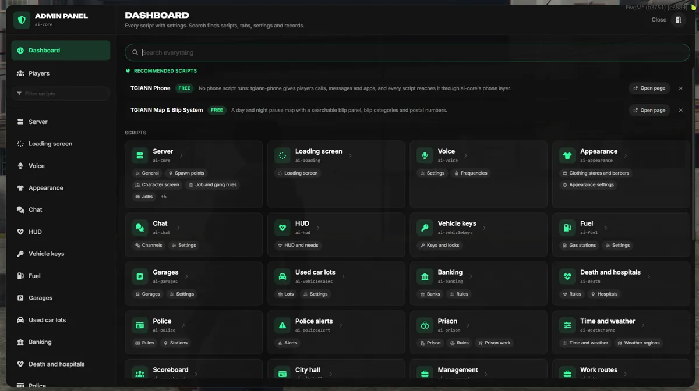
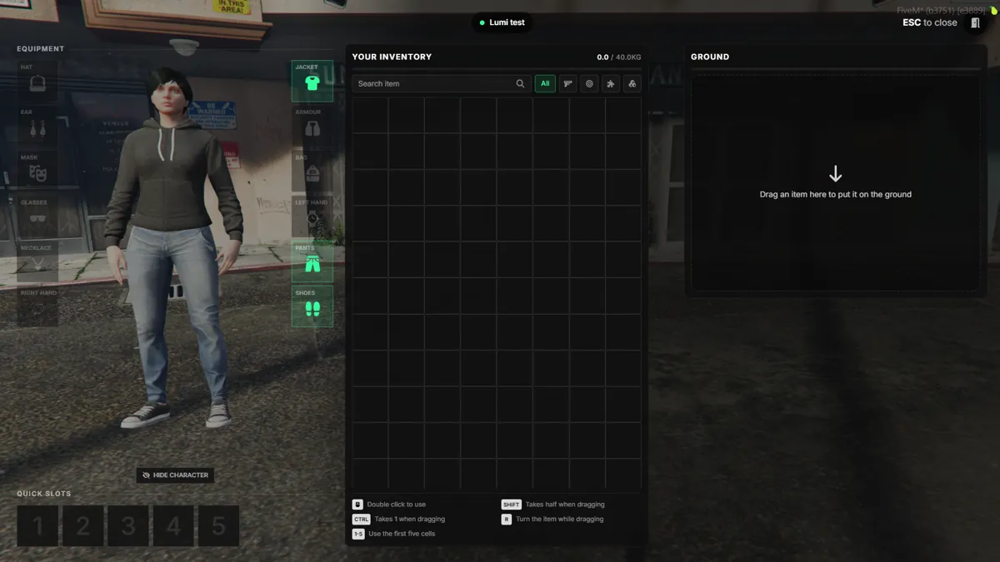
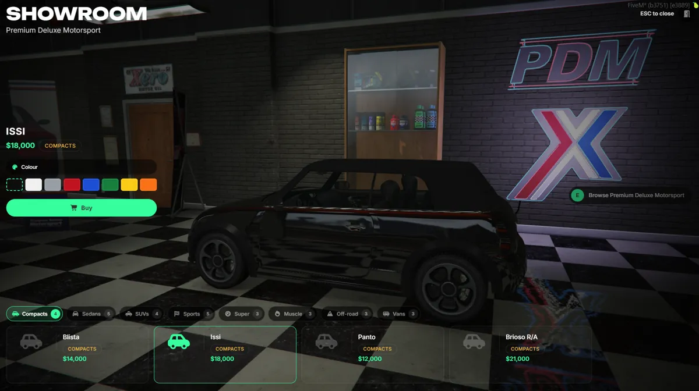

  

<h1 align="center">AI Core</h1>

  A free, open-source FiveM framework written in TypeScript. 
  Every script is set up in one in-game admin panel, and ESX, QBCore and Qbox scripts run on it unchanged.

  <a href="https://aifivem.com">Website</a> ·
  <a href="https://aifivem.com/docs">Docs</a> ·
  <a href="https://discord.gg/CNuXCnS6nY">Discord</a> ·
  <a href="https://github.com/aifivem/aicore-server">Server and txAdmin recipe</a>

---

## Why AI Core

- **One admin panel for everything.** Shops, garages, jobs, doors, hospitals, weather, HUD and every other script are configured in game, with live preview, and saved for every player at once. No config files to edit.
- **Your scripts keep working.** AI Core answers the ESX, QBCore and Qbox APIs itself, and stands in for oxmysql, ox_inventory, ox_target and pma-voice, so ready-made scripts run without changes.
- **Built for big servers.** Server-authoritative, strict security convars, snapshot + delta sync, every shared system benchmarked at 100k and 1M records.
- **Made to be extended with an AI.** Rules, notes and project skills in every repository let anyone ask an AI to change a script or write a new one, and get code that fits.

  
  
  
  

## Repositories

| Repository | What it is |
|---|---|
| [aicore-server](https://github.com/aifivem/aicore-server) | Server data folder: cfg templates, txAdmin recipe, tools, rules and docs for AI assistants |
| [ai-core](https://github.com/aifivem/ai-core) | The framework: characters, money, jobs and gangs, the admin panel, the ESX / QBCore / Qbox bridge |
| [ai-lib](https://github.com/aifivem/ai-lib) | Shared player UI (notifications, progress, menus, minigames) and the Lua lib |
| `ai-*` | One repository per script: inventory, HUD, garages, banking, police, death, robberies, vehicle shop and more |
| [docs](https://github.com/aifivem/docs) | The documentation at aifivem.com/docs |

Every repository releases on its own: release notes are grouped as New Features, Bug Fixes and Performance, and ai-core tells the server owner when a script has an update.

## Credits

AI Core learned from and builds on the open-source FiveM community: ESX, QBCore, Qbox, Overextended and many script authors. The full list with licenses is in [CREDITS.md](https://github.com/aifivem/aicore-server/blob/main/CREDITS.md).

## License

GPL-3.0-only.
